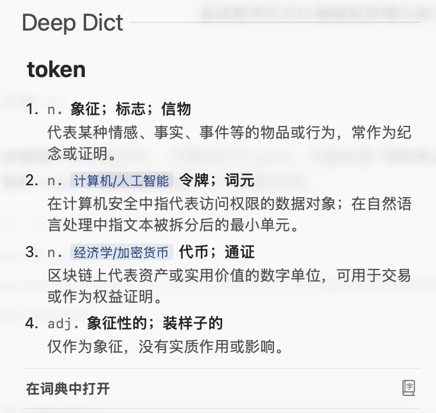

# DeepDict

离线英汉词典。划词即查，没有网络延迟，不打断阅读。96,669 词，词条由 LLM 生成，提供 macOS 词典、MDict、StarDict 等格式。



<sub>macOS 查询弹窗的界面示意。释义内容以当前版本为准。</sub>

## 下载

| 格式 | 文件 | 用在哪 |
| --- | --- | --- |
| macOS 词典 | [`DeepDict.dictionary.zip`](dictionary/DeepDict.dictionary.zip) | 系统自带的"词典"应用和查询弹窗 |
| MDict | [`DeepDict.mdx`](dictionary/DeepDict.mdx) | 欧路词典、GoldenDict、MDict 等 |
| StarDict | [`DeepDict.stardict.zip`](dictionary/DeepDict.stardict.zip) | GoldenDict、KOReader 等 |
| JSONL | [`entries.jsonl.gz`](dictionary/entries.jsonl.gz) | 想自己处理数据的人 |

## 安装

**macOS。** 解压后把 `DeepDict.dictionary` 复制到下面的目录，然后打开"词典"应用，在设置里勾选 `DeepDict`。之后在任何应用里对一个词用三指轻点，或者右键选"查询"，就能看到释义。

```sh
~/Library/Dictionaries/
```

**MDict。** 把 `DeepDict.mdx` 导入应用的词典库。这是单个文件，样式已经写在词条里，不需要额外的 `.mdd` 或 `.css`。

**StarDict。** 解压得到 `DeepDict-stardict` 文件夹，把整个文件夹放进应用的词典目录。

MDict 和 StarDict 的导入入口各个应用不同，以应用自己的说明为准。

## 收录范围

- **词汇**：常用词，技术社区和论坛里的常见说法，以及认知科学、哲学、语言学等学科的术语。
- **词形**：常见的复数、过去式等变化形式也作为独立词条收录，不依赖应用做词形还原。
- **义项**：按阅读中遇到的频率排序，罕见义项通常不收，平均每个词 1.4 个。
- **不收**：例句、音标、词源、搭配和用法说明。
- **不系统收录专有名词**：人物、机构、品牌、产品更适合查百科。

## 仓库里有什么

仓库有两块核心内容，其余都是围绕它们的工具。

| 目录 | 内容 |
| --- | --- |
| [`wordlists/`](wordlists/) | **收哪些词。** 各来源的候选词表，以及提取它们的脚本 |
| [`dictionary/`](dictionary/) | **词典结果。** 全部词条，以及各种格式的词典包 |
| [`deepdict/`](deepdict/) | 把词表变成词典的工具：生成、质量检查、打包 |

做过哪些质量检查、还有哪些没做，见 [dictionary/README.md](dictionary/README.md)。

## 开源说明

词条是 LLM 生成的，没有经过人工逐条校对，不应当作权威词典数据使用。

正式发布前，还需要明确代码、生成数据和词典包各自的许可证，并核对第三方词表来源的再分发限制。
